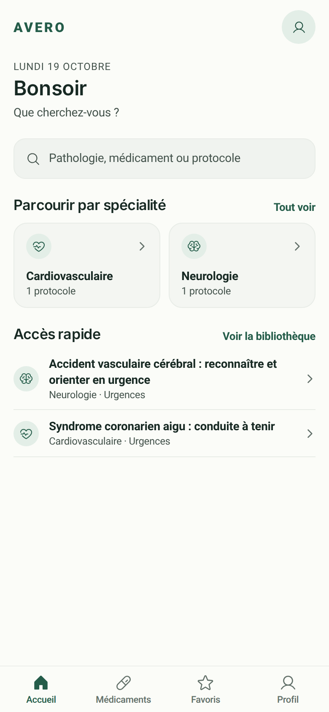
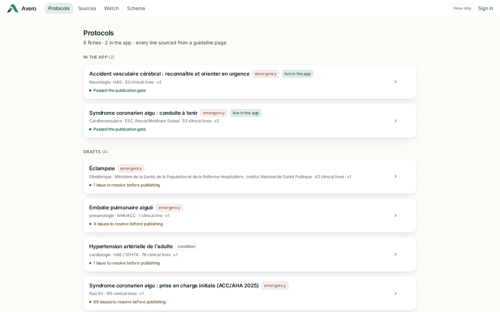
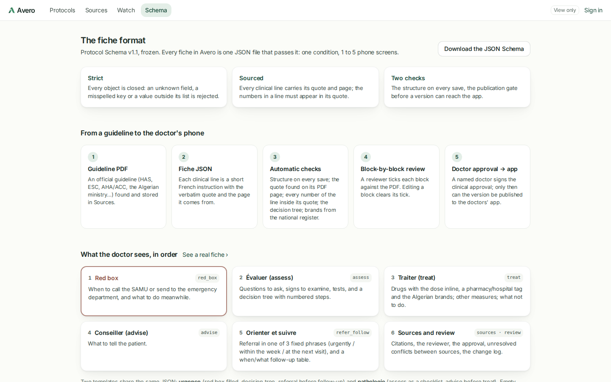

# Avero

Avero gives Algerian doctors one trusted place for up-to-date clinical protocols, with every recommendation linked to its official source.

<!-- **Live demo:** add the link once deployed -->
<!-- **Demo video:** add the link -->

## The problem

In Algeria, there is no single trusted source a general practitioner can turn to for what to do and what to prescribe.
Doctors share PDFs with each other, but these are compiled from different sources that are rarely named or updated, so
it is hard to know where a recommendation comes from or whether it is still current.

## What Avero does

- Turns official guidelines (Algerian protocols where they exist, otherwise HAS, ESC, AHA/ACC and French specialty
  societies) into short, structured protocols: one condition, one to five phone screens
- Each protocol follows the order of a consultation: when to send to emergency (red box), assess, treat, advise, refer
  and follow up
- Every recommendation carries the verbatim quote and the page of the guideline it comes from; the line itself is a
  short instruction in French, the quote keeps the source's original wording
- Drugs are given by their international name (DCI) with the dose, and with the brands registered in Algeria (the
  national nomenclature)
- Admin dashboard to add guidelines, check each protocol block by block against its PDF, and publish it
- A guideline watch flags when a newer version of a source guideline is published, and the protocols built on it

Avero is a reference tool, not a diagnosis tool.

## Screenshots

| The app: home | The app: a protocol | Dashboard: protocols | Dashboard: the protocol format |
|---|---|---|---|
|  |  |  |  |

## How it works

1. **Collect:** the crawler searches PubMed / Europe PMC and the catalogues of HAS, ANSM and French specialty societies
   for each topic, ranks the results and stores the chosen guideline PDFs with their provenance. *Automated.* An
   optional "Analyse with AI" button classifies the results with a small model (Claude Haiku, about $0.05 per topic);
   it is off unless clicked.
2. **Extract:** the text of each PDF page is read with `pdftotext` (three layouts, to cope with columns and tables).
   *Automated, no AI.*
3. **Structure:** the protocol is written in the [protocol format](docs/protocol_schema_v1.1.md): pasted into the
   dashboard as JSON, then edited in place with the PDF beside it. Every save is checked against the schema.
   *Done by the editor.*
4. **Verify:** automatic checks (structure; every quote found on its PDF page; every number of a line present in its
   quote; the decision tree has no dead ends; brands only from the national register), then a person ticks each block
   against the PDF, and a named doctor signs the clinical approval. Nothing is published before all of this passes.
5. **Serve:** the app shows the published protocols with their sources, and keeps them on the phone for offline use.

## Tech stack

- **App:** Expo 57 / React Native 0.86 (iOS, Android and web build), Expo Router, NativeWind, TanStack Query
- **Admin dashboard:** Next.js 16 (React 19), Tailwind CSS 4, react-pdf
- **Protocol format:** Zod 4 schemas shared by the app and the dashboard, exported as JSON Schema (`packages/schema`)
- **Backend / database:** Supabase (Postgres with row-level security, Auth, Storage), a FastAPI service (Python)
- **Crawling:** Crawl4AI and Playwright, NCBI E-utilities (PubMed), Europe PMC
- **Extraction:** pdftotext (Poppler)
- **AI tools:** in the product, only the optional search classifier (Claude Haiku through OpenRouter). To build it:
  Claude Code (AI pair programming)
- **Hosting:** Supabase (EU), Vercel (dashboard), Render (API and crawler, Docker)

## Project structure

```
apps/mobile         the app for doctors (iOS, Android, web), in French
apps/dashboard      the admin dashboard, in English
packages/schema     the protocol format: schemas, structure check, publication gate
packages/ui-tokens  colours, type and fonts shared by both apps
services/api        API: quote check on the PDF page, PDF storage, guideline watch
services/crawler    guideline search and download
supabase            database migrations, seed protocols, the Algerian drug register
shared              topics, sources and search configuration
content/fiches      the protocols as JSON
docs                protocol format and screenshots
```

## Run it locally

### Requirements

- Node.js 20 or later
- Python 3.12 and `pdftotext` (`sudo apt install poppler-utils`) for the API
- A Supabase project

### Setup

```bash
git clone https://github.com/mounibzaidi/avero-health.git
cd avero-health
npm install
python3 -m venv services/api/.venv && services/api/.venv/bin/pip install -r services/api/requirements.txt
```

Copy each `.env.example` to `.env.local` next to it and fill in your own keys (`.env.local` is git-ignored; no real
keys are committed to this repo):

| File | What goes in it |
|---|---|
| `.env.local` | `SUPABASE_URL`, `SUPABASE_ANON_KEY` (publishable key), `SUPABASE_DB_URL` for migrations; optional NCBI and OpenRouter keys for the search |
| `apps/dashboard/.env.local` | `NEXT_PUBLIC_SUPABASE_URL`, `NEXT_PUBLIC_SUPABASE_PUBLISHABLE_KEY`, `NEXT_PUBLIC_API_URL` (`http://localhost:8000`) |
| `apps/mobile/.env.local` | `EXPO_PUBLIC_SUPABASE_URL`, `EXPO_PUBLIC_SUPABASE_PUBLISHABLE_KEY` |

Database (a new Supabase project): the migrations in order, then the drug register and the seed protocols.

```bash
for f in supabase/migrations/*.sql; do npm run db:sql -- "$f"; done
npm run db:sql -- supabase/nomenclature.sql
npm run db:sql -- supabase/seed.sql
```

To edit in the dashboard, create a user in Supabase (Authentication → Add user), then make them an admin:
`insert into staff (user_id, role, name) values ('<user id>', 'admin', 'Your name');`
Without an account the dashboard opens read-only.

### Start

```bash
# app
npm run mobile            # in the browser; for a phone: cd apps/mobile && npx expo start

# admin
npm run api               # API on http://localhost:8000
npm run dashboard         # dashboard on http://localhost:3000

# pipeline (guideline search): see services/crawler/README.md for its own setup
cd services/crawler && .venv/bin/python literature.py --topic acs
```

### Checks

```bash
npm run typecheck && npm run lint && npm test
cd services/api && .venv/bin/python -m pytest
```

## Deploy

Supabase is already hosted. The rest deploys from this repository, and every push to `main` redeploys.

| Part | Host | Settings |
|---|---|---|
| API and crawler | [Render](https://dashboard.render.com/blueprints): New Blueprint, this repo (`render.yaml`, `Dockerfile`; free plan) | `SUPABASE_URL`, `SUPABASE_ANON_KEY`, `CORS_ORIGINS` = the dashboard's address; optional NCBI and OpenRouter keys |
| Dashboard | [Vercel](https://vercel.com/new): import the repo, Root Directory `apps/dashboard` (Next.js is detected) | `NEXT_PUBLIC_SUPABASE_URL`, `NEXT_PUBLIC_SUPABASE_PUBLISHABLE_KEY`, `NEXT_PUBLIC_API_URL` = the API's address |
| App for the web (optional) | Vercel, a second project with Root Directory `apps/mobile` (`apps/mobile/vercel.json`) | `EXPO_PUBLIC_SUPABASE_URL`, `EXPO_PUBLIC_SUPABASE_PUBLISHABLE_KEY` |

Only publishable keys are used: the database's own rules protect every write. Without `NEXT_PUBLIC_API_URL` the
dashboard still runs, with the guideline search hidden.

## Protocol format

Each protocol is one JSON document (stored in Postgres as numbered versions) with these sections: red box (when to
call the SAMU, what to do meanwhile), assess (ask, examine, tests, decision tree), treat (medications, other measures,
what not to do), advise, refer and follow up, sources and review. Every clinical line has a source reference: the
source, the printed page and the verbatim quote. The format is strict: an unknown field or a value outside its list
is rejected. See [docs/protocol_schema_v1.1.md](docs/protocol_schema_v1.1.md), or the **Schema** page of the dashboard,
which has a live validator.

## Current status and limitations

- Published in the app: acute stroke (AVC), acute coronary syndrome. Drafts: eclampsia, acute pulmonary embolism,
  adult hypertension
- The guideline PDFs of the two published protocols are not yet uploaded to storage, so the dashboard shows each
  line's quote but not the PDF page beside it
- Content is for professional reference and must be verified against the linked source

## Who built what

Built solo by **Mounib Zaidi** (MD, Algiers) during Thirduni Cohort 1, October 2026: product design, clinical content
and verification, crawler and extraction pipeline, admin dashboard, app, deployment. Written with Claude Code as an
AI pair programmer.

This repository starts on 15 October 2026 from an earlier prototype of the same project, from which the crawler, the
app's search and parts of the dashboard were carried over.

## What's next

- More conditions, prioritised by what GPs use most
- Algerian protocols wherever they exist
- Working with Algerian medical societies to publish their protocols through Avero
